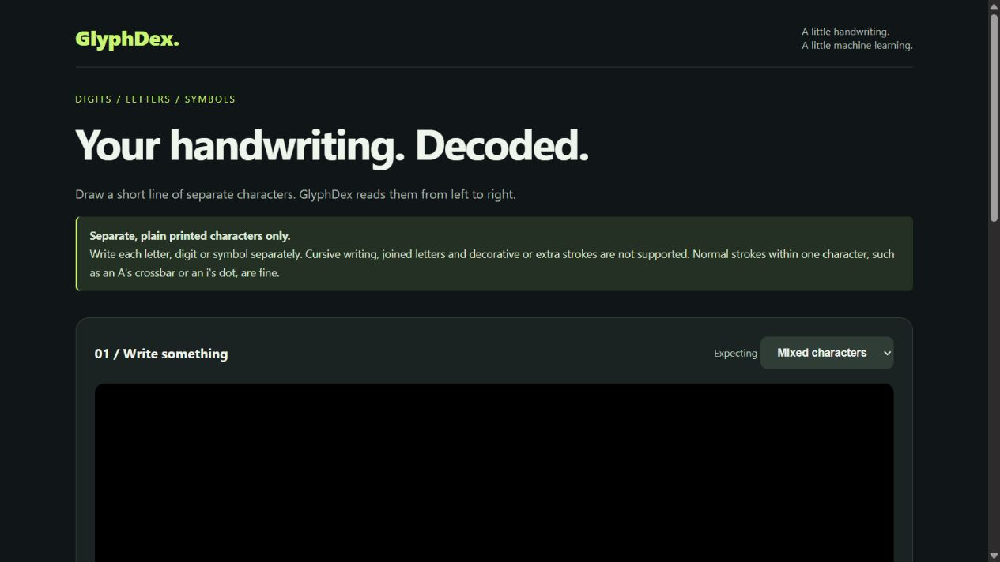
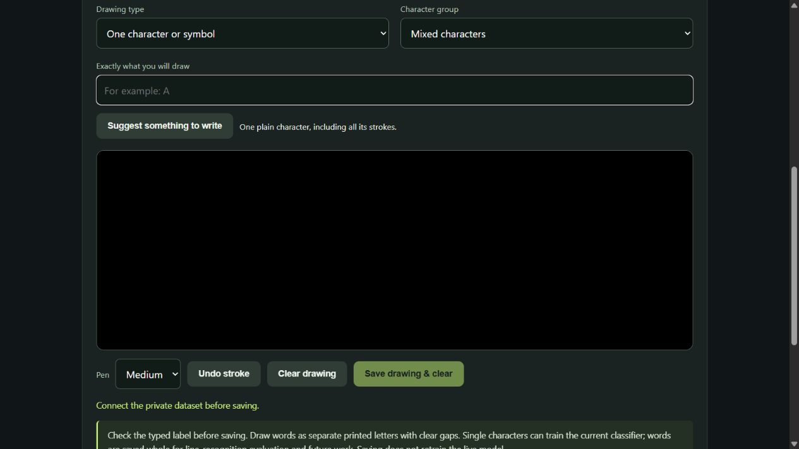

# GlyphDex — Handwriting recognition

Draw a short line of **separate digits, uppercase/lowercase letters and supported symbols**. GlyphDex splits the drawing into characters and reads them from left to right. Choose mixed, digits, uppercase, lowercase or symbols mode. Uncertain readings show `?`; confirm a suggestion or enter the correct character before copying. Undo strokes and copy the result.

Supported: `0–9`, `A–Z`, `a–z`, and `+ - / < > # $ % & [ ] { } × ÷ ± ≤ ≥ ≠ ≈ =` (83 classes). The equals sign uses generated two-stroke training examples and is experimental. `!`, `?`, `@`, commas, parentheses and other unlisted punctuation are not trained classes.

Write one spaced line with up to 32 characters. Dots and stacked strokes remain together when their horizontal ranges overlap; a small, slightly offset dot above a neighbouring stem is also merged. Joined cursive, overlapping characters, multiple lines and badly separated strokes remain unsupported. Spaces are estimated from larger gaps. O/0, I/l/1, and letter case can be visually ambiguous. Rejection uses conservative score, margin and shape rules, plus known mixed-mode ambiguities; it is not calibrated and cannot detect every unsupported input or confidently wrong answer.

**Live app:** [digidex-dakshesh.onrender.com](https://digidex-dakshesh.onrender.com/)

**Temporary drawing studio:** [Collect private training examples](https://digidex-dakshesh.onrender.com/collect). The recognition app and collection studio have separate interfaces.

## Screenshots

### Recognition website



### Temporary drawing studio



Screenshots show the deployed interface on October 27, 2026, with blank canvases. The studio screenshot is disconnected and contains no private drawings, dataset contents or access keys. Connect with your private owner key to enable saving.

## Trained model

The character model was trained in the owner's logged-in **Google Colab T4 GPU** session. Full Keras and equivalent NumPy weights for both the new model and retained baseline are committed in [`models/characters/`](models/characters/), with labels, measured metrics, verification examples and a model card. Training and inference share [`character_preprocessing.py`](character_preprocessing.py).

The model is a custom TensorFlow/Keras CNN trained on EMNIST letters/digits and a selected HASYv2 symbol subset. It receives one normalized 28x28 grayscale character and predicts one of 83 classes:

```text
28x28 grayscale input
  -> Conv2D(48, 3x3, ReLU) -> MaxPool(2x2)
  -> Conv2D(96, 3x3, ReLU) -> MaxPool(2x2)
  -> Flatten -> Dense(192, ReLU) -> Dropout(0.3)
  -> Dense(83, softmax)
```

Focused modes use the v2 CNN. Mixed mode combines character probabilities from two separately trained CNNs: **25% v2 + 75% baseline**. These percentages are model weights, not accuracy figures. The blend limits mixed-mode regressions observed with v2 alone; similar-looking characters remain difficult.

| Recognition mode | Held-out accuracy | Test characters |
| --- | ---: | ---: |
| Digits | **99.40%** | 3,000 |
| Uppercase letters | **97.67%** | 7,800 |
| Lowercase letters | **93.28%** | 7,800 |
| Symbols | **98.39%** | 1,616 |

Each result measures classification before uncertainty checks and assumes the correct focused mode is selected. These are individual-character results, not mixed-mode, complete-word or live website accuracy. Synthetic `=` is excluded. See the [model card](models/characters/MODEL_CARD.md) for mixed-mode results by category and evaluation limitations.

The original training run is preserved in [`GlyphDex_Characters_Colab.ipynb`](GlyphDex_Characters_Colab.ipynb). The new [`GlyphDex_v2_Colab.ipynb`](GlyphDex_v2_Colab.ipynb) has 12 numbered code sections for GPU setup, downloads, data preparation, stroke augmentation, training, separate mode evaluation, class-balanced fine-tuning, baseline comparison and export. Use **Runtime → Run all** on a free Colab T4. It uses more EMNIST examples and varied stroke thickness. The released model trained for 15 initial epochs and 9 class-balanced fine-tuning epochs. Focused modes use v2. Mixed mode uses 25% v2 and 75% baseline probabilities, selected on shared held-out EMNIST validation with a category regression gate. The model card records the mixed-mode tradeoffs; improvements are modest and real mouse-drawing accuracy is not yet established. Training requires TensorFlow; the deployed app only needs NumPy, Pillow, Flask, Gunicorn and Psycopg for optional private storage. Complete-line and real website accuracy require their own held-out evaluation.

### Corrected website examples

Use the temporary private [GlyphDex Studio](https://digidex-dakshesh.onrender.com/collect) at `/collect` to collect data. The main recognition page has its previous interface and does not connect to the online dataset or upload corrections. Its existing browser-only export controls remain available.

In the studio, connect once with the existing owner key, keep a consistent writer ID, select **One character or symbol** or **Word, number or short line**, type exactly what you will draw, then draw and choose **Save drawing & clear**. A suggestion button provides practice targets. Saving queues the image, label, original stroke coordinates and drawing identity privately, then clears the canvas for another example. The online count confirms successful uploads. No model prediction is needed. Individual glyphs can train the classifier; words and expressions remain whole-line samples for evaluation and future line-recognition work. They are not automatically split into classifier labels.

The studio reuses the existing free Render service and private Aiven database. It is excluded from search indexing; dataset access still requires owner authentication. Keys are not stored in browser storage. Pending drawings survive refreshes and retry automatically after temporary failures. **Dataset controls & backups** offers pause, sync, private export, queued backup and disconnect. Keep private exports out of public repositories. Removing the temporary studio later does not require deleting collected data.

Open [`GlyphDex_Private_Dataset_Colab.ipynb`](GlyphDex_Private_Dataset_Colab.ipynb) in your private Colab session to download the dataset with a hidden key prompt and prepare `website_corrections.npz`. Keep the JSON, NPZ, access key and executed notebook private. Nothing is uploaded to public GitHub. This notebook prepares data only; retraining remains a separate action.

For one person's handwriting, select `drawing` splits: all crops from one canvas stay together across train, validation and test. This evaluates personalization on held-out drawings, not unseen writers. At least three distinct drawings are required; substantially more diverse examples are needed for useful improvement. For a general handwriting benchmark, collect at least three real writers and use `writer` splits. Never invent writer IDs to satisfy that requirement. Conflicting duplicate labels are rejected.

Upload the prepared `website_corrections.npz` through the training Colab Files panel before running the v2 notebook. Section 6 adds only training and validation examples. Section 10 evaluates separate website test examples by recognition mode. Keep the split report with the trained model so personalization results are not presented as unseen-writer accuracy. Without that file, training uses only public datasets. Collect varied examples and inspect labels before retraining; collecting corrections does not automatically change the live model.

Full lines evaluate the complete prediction pipeline separately. Run `python evaluate_lines.py glyphdex-private-dataset.json --split-report website_corrections.json`. The report selects held-out writers or drawings and counts rejected characters, wrong spaces and request errors as failures. Omitting the split report is exploratory. Full lines never automatically enter classifier training.

The original **MNIST-only** model remains in [`models/`](models/) for compatibility with requests that omit `mode`:

- [`mnist_cnn.keras`](models/mnist_cnn.keras): complete Keras model.
- [`mnist_cnn_weights.npz`](models/mnist_cnn_weights.npz): equivalent weights used by the lightweight NumPy web runtime.
- [`metrics.json`](models/metrics.json): measured results; [`MODEL_CARD.md`](models/MODEL_CARD.md): training details and limitations.

Its original training notebook is [`DigiDex_Colab_Training.ipynb`](DigiDex_Colab_Training.ipynb); its test accuracy is 98.86% on 10,000 MNIST test digits.

## Run locally

```bash
pip install -r requirements.txt
python app.py
python -m unittest discover -v
node test_dataset_sync.js
```

Open http://127.0.0.1:5000. Tests compare NumPy inference with Colab Keras outputs for both exports, check mixed-character HTTP recognition, dotted/stacked glyph segmentation, blank drawings, limits and malformed input. Inference processes at most four characters at once to bound memory on Render Free.

### Prediction API

`POST /predict` accepts `{"image":"data:image/png;base64,...","mode":"mixed"}`. The canvas is white ink on black. Supported modes: `mixed`, `digits`, `uppercase`, `lowercase`, `symbols`. The response includes `text`, ordered `characters`, `suggestion`, `uncertain`, `reasons`, canvas-coordinate bounding boxes, model scores and three alternatives. Rejected characters use `?`, which is a placeholder rather than a trained punctuation class. Omitting `mode` retains the original single-digit response. Images are capped at 1024×1024 and 2 MB per request. Server predictions are processed in memory and are not stored; explicit corrections are saved only when the owner enables private collection; browser-only exports remain available.

## Render deployment

Create a Python web service from this repository on the Free plan. Build: `pip install -r requirements.txt`. Start: `gunicorn --workers 1 --threads 2 --timeout 120 --bind 0.0.0.0:$PORT app:app`. Health check: `/healthz`. Python 3.12.14 and `OPENBLAS_NUM_THREADS=1`. These settings are also in `render.yaml`. Free services sleep when idle; the first request may take longer. For a public-repository service, use Render's manual deploy control after GitHub updates unless automatic deployment is configured.

### Private dataset configuration

Configure `GLYPHDEX_DATABASE_URL` with a dedicated restricted PostgreSQL role, `GLYPHDEX_DATABASE_CA` with the provider CA certificate, `GLYPHDEX_DATASET_KEY_HASH` with SHA-256 of a random owner key, and `GLYPHDEX_DATASET_SESSION_SECRET` with a separate random session secret. TLS verifies the database hostname and CA. Keep values in Render secret environment settings, never source control. A dedicated database owner runs `DatasetStore.initialize()` once, then grants the web role only schema USAGE and table SELECT, INSERT, UPDATE. The web app cannot create tables or delete examples. Without configuration, recognition and local exports still work.

`POST /dataset/session` accepts an owner key and creates the browser session. Cookie-authenticated writes require `X-Dataset-CSRF` and the same HTTPS origin. Colab uses `Authorization: Bearer <owner-key>` for `GET /dataset/export?limit=200&cursor=...`. Exports are private and uncached. Each page includes `examples`, `lines`, and `next_cursor`; follow pages until the cursor is null. No key or database URI appears in API error messages.

## Project history

GlyphDex began as DigiDex, a single-digit MNIST experiment. Original research notebooks are retained for historical context. The current release uses the character CNN and deployment described above; older digit-only experiment plots are not presented as current GlyphDex results.
